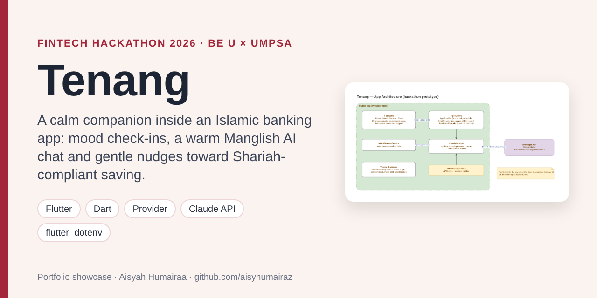
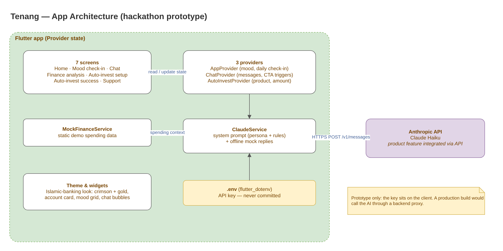
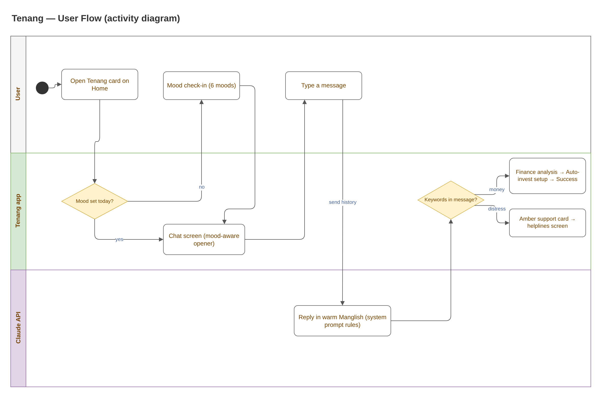

# Tenang — AI Wellness & Financial Companion (Hackathon Prototype)

> **Portfolio showcase.** Source code is private; a live walkthrough or code review is available on request.

**Type:** Team hackathon project — Hackathon X: Fintech Forward 2026, Be U by Bank Islam × UMPSA  
**Role:** Built the Flutter prototype (all app code); feature ideas planned together with my team  
**Period:** May 2026  
**Status:** Unfinished prototype. Finance data is mock data; it is not connected to a real bank.  
**Result:** Strongly positive written feedback from the judges for user-centric design and originality

## The problem

Many university students feel stressed about money but do not want to open a banking app full of numbers and jargon. Financial advice also lands badly when someone is upset.

## The idea

Put a calm companion inside an Islamic banking app. It asks how the user feels first, talks in friendly Manglish (Malay + English), and only shows spending analysis when the user brings up money. If spending is the issue, it suggests small automatic savings into Shariah-compliant products. If the user sounds distressed, it shows helplines.

## Key features

| Feature | What it does |
|---|---|
| Mood check-in | 6 moods, saved once per day; the chosen mood shapes how the chat opens |
| Tenang AI chat | Claude Haiku with a warm Manglish persona and clear rules (feelings first, no diagnosis, never pushy) — *product feature integrated via API* |
| Offline fallback | Built-in mock replies so the full UI can be demoed without an API key |
| Finance analysis | Spending breakdown appears only when money keywords are detected |
| Auto-invest setup | Pick Shariah-compliant products (Tabung Haji, ASNB, SSPN-i, Unit Trust-i) and an amount in a few taps |
| Safety escalation | Distress keywords show a gentle support card that leads to a helplines screen |

## Screenshots

*Screenshots will be added from a fresh build of the prototype.*

## System design

**App architecture**  

**User flow (activity diagram)**  

*Editable `.drawio` files are in [`docs/diagrams`](docs/diagrams) (open with [app.diagrams.net](https://app.diagrams.net)).*

## My contribution

- Built the Flutter app: 7 screens, 3 Provider state classes, the theme and 8 reusable widgets.
- Wrote the chat logic: mood-aware openers, keyword triggers for the finance and support flows, and the call to the Claude API with an offline fallback.
- Designed the Islamic-banking look (crimson and gold palette, account card, mood grid, chat bubbles).
- Worked with my team to plan the features, the persona rules and the product list for the pitch.

## Engineering highlights

- **Feelings first, money second.** The system prompt and the client-side keyword checks work together: finance screens are offered only after money comes up, and distress words always surface the support card.
- **Demo-proof.** If no API key is set, the service returns built-in Manglish replies so judges can still walk through the whole flow.
- **Secrets kept out of git.** The API key is read with `flutter_dotenv` from a `.env` file that is git-ignored.
- **Known limitation (prototype).** The AI call is made from the client. A production version would route it through a backend proxy and use real, consented transaction data.

## Tech stack

| Layer | Technology |
|---|---|
| App | Flutter, Dart, Material 3 |
| State | Provider |
| AI | Anthropic Claude Haiku via HTTPS (`package:http`) |
| Config | flutter_dotenv, shared_preferences |

## How I used AI tools while building this

I used an AI coding assistant (Claude Code) as a **pair-programmer** for boilerplate, refactoring suggestions, debugging and drafting parts of the UI. The app idea, flow, persona rules and design decisions came from me and my team, and I reviewed and ran every change.

Separately, the chat feature itself is an AI product feature: it calls the Claude API.

## Contact

**Aisyah Humairaa binti Abdul Aziz** — Software Engineering student, UMPSA  
Email: aisyahhumairaa287@gmail.com  
LinkedIn: [linkedin.com/in/aisyah-humairaa-9888581a6](https://www.linkedin.com/in/aisyah-humairaa-9888581a6)

© 2026 Aisyah Humairaa binti Abdul Aziz. Shared for portfolio viewing only; all rights reserved.
